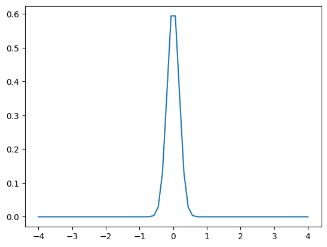
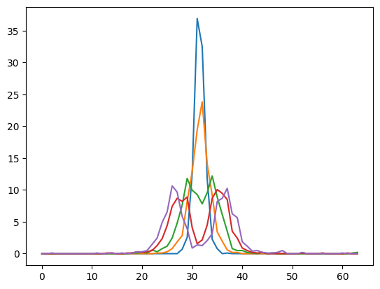
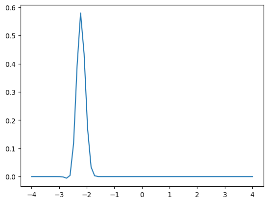
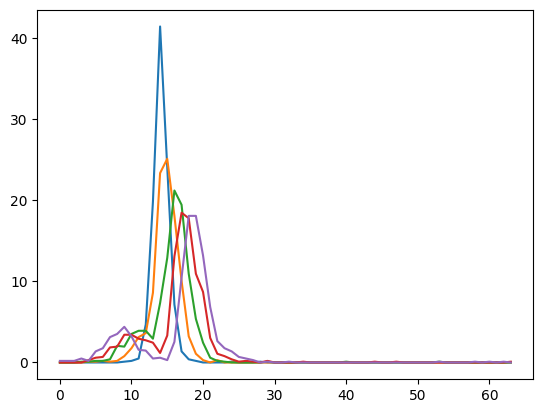

# 1D Quantum Mechanics Simulation

A self-directed educational exploration of 1D, single-particle Schrödinger evolution using Qiskit circuits. The notebooks study free Gaussian wavepackets, a step potential, and a finite barrier. **QFT/split-operator methods are established approaches; this is not a new simulation algorithm.**

> **Physics status:** The historical notebooks and figures have not yet passed independent statevector validation. Initial inspection identified an aliased incoming momentum, discrepancies between potential phase masks and plots, and kinetic/potential phase-convention questions. See [the audit](docs/PHYSICS_AUDIT.md). The added NumPy reference has its own passing unit tests; this does **not** validate the original Qiskit notebooks.

## Model and numerical method

The time-independent Hamiltonian is `H = T + V`, with `T = -ħ²∂²/(2m∂x²)`. Evolution is `U(dt) = exp(-i H dt / ħ)`. The QFT changes between position and momentum representations, in which potential and kinetic operators are diagonal respectively. A symmetric **second-order Strang split** is `exp(-iVdt/2ħ) F⁻¹ exp(-iTdt/ħ) F exp(-iVdt/2ħ)`. This formula describes the *new NumPy reference*; it is **not** a claim about the historical Qiskit circuits' actual implementation. Fourier grids use periodic boundaries, so edge wraparound is possible.

## Original notebooks

| Case | Notebook | Status |
|---|---|---|
| Free packet | [time_evolution_free_particle.ipynb](Notebooks/time_evolution_free_particle.ipynb) | Original visualizations retained; detailed audit pending |
| Step potential | [Step_potential.ipynb](Notebooks/Step_potential.ipynb) | Phase mask currently differs from plotted step |
| Finite barrier | [quantum_tunnelling.ipynb](Notebooks/quantum_tunnelling.ipynb) | Phase mask differs from plotted barrier; tunneling claim unverified |

Preserved original free-particle illustrations (historical, not proof of physical accuracy):

| Initial stationary | Later stationary | Initial travelling | Later travelling |
|:---:|:---:|:---:|:---:|
|  |  |  |  |

## Reproduce baseline checks

Python 3 with NumPy suffices for the baseline tests. `requirements.txt` includes optional Qiskit dependencies for opening and eventually validating the original notebooks (not yet compatibility-tested in a clean Qiskit environment).

```bash
python -m venv .venv
# Activate: source .venv/bin/activate (macOS/Linux) or .venv\Scripts\Activate.ps1 (PowerShell)
python -m pip install -r requirements.txt
python -m unittest discover -s tests -v
```

The baseline [reference_split_step.py](reference_split_step.py) uses an FFT-grid Strang split with default `m=ħ=1`. Use a uniform grid **without a repeated endpoint**: `np.linspace(-4, 4, 64, endpoint=False)`. Wavefunction amplitudes satisfy `sum(|ψ_j|²)=1`; the Gaussian's `sigma` denotes the probability-density standard deviation. Tests check analytic free plane-wave phase, constant potential, normalization, norm preservation, and reversibility.

**Limitations:** Sampled circuit histograms have finite-shot noise. The original implementations need explicit bit ordering, Fourier/momentum sign, potential-mask and statevector comparison checks. Transmission beyond a potential barrier is not by itself proof of quantum tunneling. No real-hardware, quantum-advantage, novel-algorithm, or publication claims are made.

## Attribution

- Giuliano Benenti and Giuliano Strini, [*Quantum simulation of the single-particle Schrödinger equation*](https://arxiv.org/abs/0709.1704) (2008): established quantum simulation methods.
- Mohamed Abouelela, [*Quantum Simulation of the Schrödinger Equation using IBM's Quantum Computers*](https://fount.aucegypt.edu/capstone/20/) (2020): related Qiskit educational exploration.
- Lohit Potnuru, *Simulate Quantum Particles with Python and Qiskit* (2022): cited educational influence; source URL still to be verified.

This project represents independent study/adaptation of pre-existing methods to illustrative 1D potentials. Validation of Qiskit implementations remains future work.
